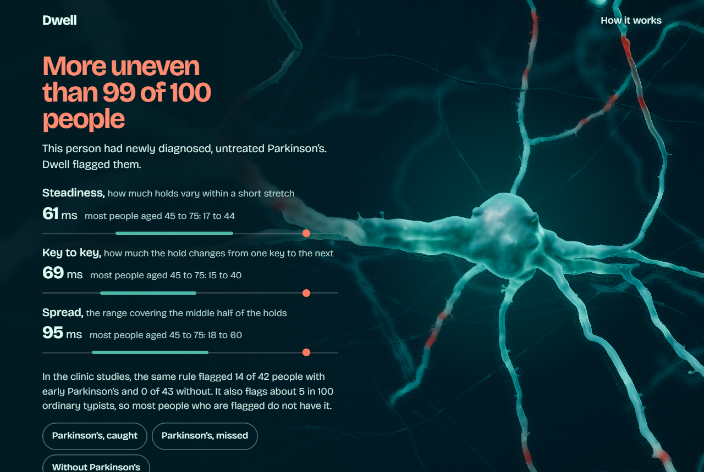
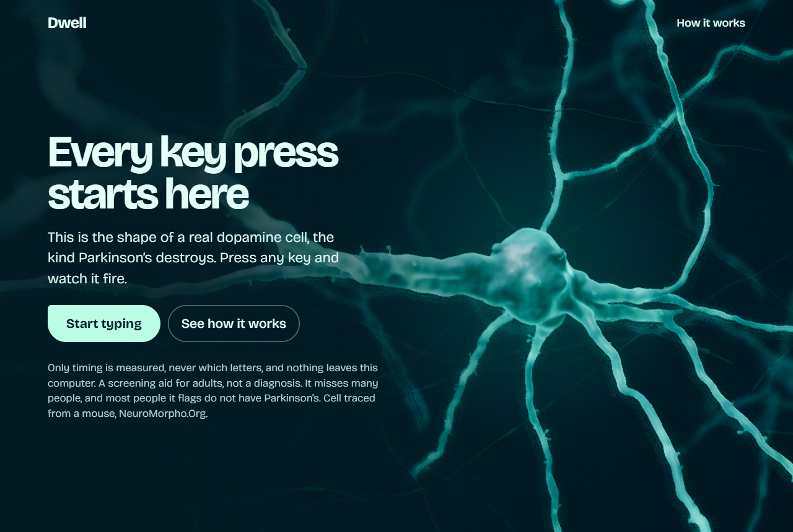
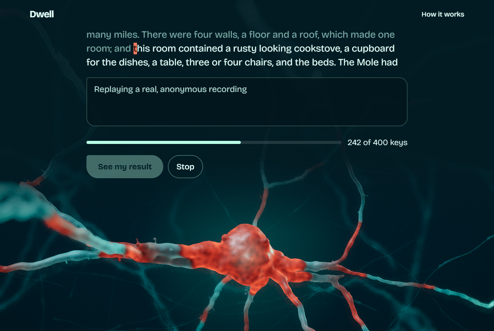

# Dwell

**Type for about two minutes, and Dwell checks the rhythm of your key presses for the kind of unevenness seen in early Parkinson's disease. It measures timing only, never which letters, and nothing leaves your computer.**

Live: **https://dwell-typing.vercel.app** (any computer with a keyboard, no account, free)



Dwell is a screening aid for adults. **It is not a diagnosis.** It misses many people with Parkinson's, and most people it flags do not have it. The numbers are below.





The picture is a real neuron. Its branches come from a dopamine cell in the substantia nigra of a mouse, traced under a microscope. Each key you press sends a pulse down them; holds far from your own middle leave late and turn coral. It is a picture of your typing, not a recording of a brain, and it has no part in the score.

## How it works
1. **Record.** You copy a short passage. Dwell records when each character key goes down and up. The character itself is never stored (`src/core/capture.ts`).
2. **Refuse what cannot be judged:** touch keyboards, too few keys, mashing, scripts, timers that are too coarse, lost key releases, speeds outside the reference.
3. **Measure unevenness** with three numbers: spread of holds (`iqr`), variation within stretches of 50 keys (`wsd`), and change from one key to the next (`adj`).
4. **Score.** A logistic model with weights learned from 85 people in two clinic studies.
5. **Compare.** The score becomes a percentile among the browser typists closest to you in age *and* typing speed (9,145 people). The most uneven 5 in 100 are flagged.
6. **Repeat.** Sessions are kept on your computer as a few summary numbers, so you can see whether a flag lasts.

## Results
The rules were written in [research/PROTOCOL.md](research/PROTOCOL.md) and committed **before** the model was built. Deviations are listed there.

| Question | Data | Result |
|---|---|---|
| Learn from early Parkinson's, test on newly diagnosed and untreated | CS1 → CS2, 54 people | AUC **0.80 [0.67, 0.91]** |
| The reverse | CS2 → CS1, 31 people | AUC **0.79 [0.59, 0.93]** |
| Each person held out in turn | 85 people | AUC 0.80 [0.70, 0.89] |
| People with Parkinson's flagged (model from the other study) | 42 people | **14 of 42** (33.3 % [21.0, 48.4]) |
| People without it flagged by mistake, same rule | 43 people | **0 of 43** |
| Ordinary browser typists aged 40+ flagged (not used for calibration; seen once before, when choosing speed matching) | 6,376 people | **5.5 % [5.0, 6.1]** |
| Same person on two visits, score | 31 people | ICC **0.94** (0.97 among people without Parkinson's) |
| Same person on two visits, same flag or no flag | 31 people | 26 of 31 |
| Flagged at **both** visits | 18 with, 13 without | 6 of 18, 0 of 13 |
| **At home**, own computers, self-reported diagnosis (Tappy) | 100 people aged 40+ | AUC 0.60 [0.48, 0.72]: **not established** |

AUC is the chance that a random person with Parkinson's scores higher than a random person without it; 0.5 is guessing. Brackets are 95 % intervals over people.

**Compared with other measures of the same 85 people:** typing speed 0.56 [0.44, 0.68]; single-key tapping test in clinic 0.61 [0.49, 0.73]; alternating tapping test in clinic 0.83 [0.74, 0.92]; the published neuroQWERTY index 0.81 [0.71, 0.90]. Dwell is about level with the last two, not better.

**What a flag means.** If 1 in 100 people of that age have Parkinson's, about **6 of 100** flagged people would have it (11 if it is 2 in 100). That is why Dwell asks people to repeat the test and never uses the word "positive".

## Design choices, and the evidence for them
- **Simple model.** Chosen by cross-validation inside the training study only. Best inner AUC by type (CS1): logistic C=0.03 0.84, logistic C=0.1 0.86, logistic C=1 0.90, SVM 0.88, random forest 0.81, boosting 0.84. Forests and boosting did not beat logistic regression on samples this small.
- **Browser calibration.** With the clinic's own threshold, 21 % of ordinary browser typists over 40 were flagged. That broke the 15 % stop rule in the protocol, so the app may not use it.
- **Matching on speed.** Compared by age only, slow typists were flagged two to three times as often as fast ones. Matching on speed as well evens this out (table below) at no loss: 14 of 42 caught.
- **The labels are not doing the work.** An equal-weight score that never sees a Parkinson's label reaches AUC 0.81 and 0.78. The signal is the unevenness itself.
- **Length.** Cross-study AUC by number of keys: 100: 0.80/0.77, 150: 0.80/0.77, 200: 0.81/0.77, 300: 0.81/0.79, 400: 0.81/0.79, 500: 0.81/0.78, 750: 0.82/0.78, 1000: 0.81/0.79. The app asks for 300.
- **Coarse timing.** Rounded to 16 ms, like a rough keyboard: 0.81 / 0.82.

<details><summary>False alarm rate by group (browser typists not used for calibration)</summary>

| Group | People | Flagged |
|---|---|---|
| age 18-29 | 2,110 | 5.2 % [4.3, 6.2] |
| age 30-39 | 552 | 5.1 % [3.5, 7.2] |
| age 40-49 | 3,763 | 4.8 % [4.1, 5.5] |
| age 50-59 | 2,031 | 7.1 % [6.1, 8.3] |
| age 60-69 | 448 | 4.9 % [3.3, 7.3] |
| age 70-90 | 134 | 4.5 % [2.1, 9.4] |
| fingers 1-2 | 809 | 5.2 % [3.9, 6.9] |
| fingers 3-4 | 438 | 5.7 % [3.9, 8.3] |
| fingers 5-6 | 355 | 7.6 % [5.3, 10.8] |
| fingers 7-8 | 825 | 4.8 % [3.6, 6.5] |
| fingers 9-10 | 3,949 | 5.5 % [4.9, 6.3] |
| keyboard_type full | 3,238 | 5.3 % [4.6, 6.1] |
| keyboard_type laptop | 3,138 | 5.7 % [5.0, 6.6] |
| gender female | 4,280 | 5.8 % [5.2, 6.6] |
| gender male | 1,061 | 2.8 % [2.0, 4.0] |
| gender none | 1,035 | 7.1 % [5.6, 8.8] |
| wpm 0-20 | 117 | 10.3 % [6.0, 17.1] |
| wpm 20-35 | 1,092 | 5.2 % [4.1, 6.7] |
| wpm 35-50 | 1,944 | 6.4 % [5.4, 7.6] |
| wpm 50-70 | 2,272 | 5.3 % [4.4, 6.3] |
| wpm 70-200 | 951 | 4.0 % [2.9, 5.4] |

Groups by fingers, keyboard, gender and speed are people aged 40 and over.
</details>

## Limits
- **Early, not "years early".** The studies compare people already diagnosed (some newly, and untreated) with people who are not. Nothing here shows detection before diagnosis.
- **Small clinic samples**: 42 with, 43 without, all from two hospitals in Madrid, one laptop model. The intervals are wide.
- **It misses two in three** at the flag level.
- **Home use is not established.** On Tappy the AUC is 0.60, and people *without* Parkinson's were flagged 27 % of the time, so the browser calibration does not carry over to that recorder. Tappy labels are self-reported and many people were on medication.
- **The clinic files give no ages**, so clinic people are compared with the age-60 reference. Using 50 or 70 instead catches the same number.
- **Browser typists were not asked about Parkinson's.** A few probably have it, so the false alarm rate is slightly overstated.
- Not for under 40 (shown as a demonstration and not saved), touch screens, or hands affected by something else.
- Any clinic claim would need a study designed for it.

## Run it
```bash
git clone https://github.com/vrun-systems26/dwell && cd dwell
npm install
npm run dev       # http://localhost:5173
npm test          # app numbers equal the Python research code; refusals
npm run build && npx vite preview --port 5190   # then: npx tsx tests/browser.ts
```
Research (Python 3.11+, numpy, pandas, scikit-learn). Put the data in `../dwell-data` (or set `DWELL_DATA`):
[neuroQWERTY MIT-CSXPD](https://physionet.org/content/nqmitcsxpd/1.0.0/) in `nq/`, [Tappy](https://physionet.org/content/tappy/1.0.0/) in `tappy/`, [Aalto 136M](https://userinterfaces.aalto.fi/136Mkeystrokes/) `Keystrokes.zip`. Then `cd research` and run `evaluate.py`, `aalto.py`, `browser.py`, `fairness.py`, `final.py`, `examples.py`.

## Data and credits
- **neuroQWERTY MIT-CSXPD**: Giancardo L. et al. *Computer keyboard interaction as an indicator of early Parkinson's disease.* Sci. Rep. 6, 34468 (2016). ODC-By 1.0. Three anonymous recordings (timings only) are included as examples, chosen by a fixed rule. The idea that key hold times carry this signal is theirs.
- **Tappy Keystroke Data**: Adams W. R. PLoS ONE 12(11) (2017). PhysioNet, open access.
- **136M Keystrokes**: Dhakal V., Feit A. M., Kristensson P. O., Oulasvirta A. *Observations on Typing from 136 Million Keystrokes.* CHI 2018. Free for non-commercial use with attribution. Only smoothed percentile tables computed from it are included, so `model.json` is for **non-commercial** use.
- Passages: openings of *The Wonderful Wizard of Oz*, *The Wind in the Willows* and *Alice's Adventures in Wonderland*, all public domain.
- **Neuron shape**: cell MYUX58R (and MYUX100, blurred behind it), Henny archive, [NeuroMorpho.Org](https://neuromorpho.org). Meza R. C., López-Jury L., Canavier C. C., Henny P. *Role of the Axon Initial Segment in the Control of Spontaneous Frequency of Nigral Dopaminergic Neurons In Vivo.* J. Neurosci. 38, 733 (2018). Branch paths and relative thickness are real; thickness is exaggerated and small bumps are added (`research/neuron_shape.py`).
- Font: Bricolage Grotesque (SIL OFL 1.1). Built with Vite, TypeScript, three.js, scikit-learn and Playwright, with AI coding assistance (Claude Code).

Code: MIT. Not a medical device.
